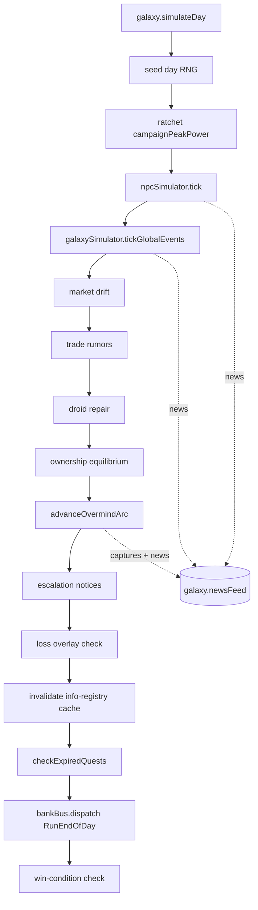
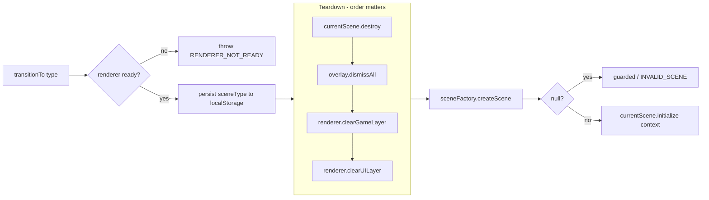
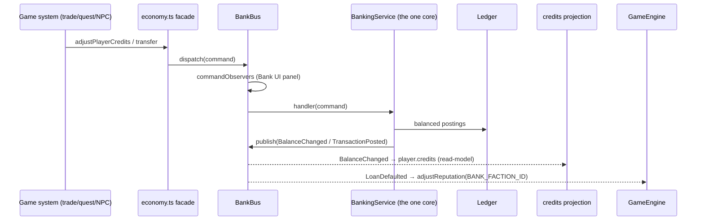

# Data-Flow

The paths data actually takes through the running game. Each flow lists the ordered
call chain with `file:line` anchors. Companions:
[`SEAMS.md`](./SEAMS.md) (the ports these flows cross),
[`BUSES.md`](./BUSES.md) (the channels they ride),
[`MODULES.md`](./MODULES.md) (the layer map).

`GameEngine` (`src/systems/GameEngine.ts`) is the orchestrator every flow passes
through.

> **Anchors verified against `047438ef` (2026-07-31).** Symbol names are
> authoritative; `file:line` numbers are a convenience and drift on every edit.
> Cited symbols are guarded by `src/tests/architecture/docAnchorsExist.test.ts`.
> Diagrams render on GitHub (Mermaid).

---

## 1. Frame loop (real-time)

Drives per-frame scene updates and adaptive music. **Time unit: milliseconds** since
the last frame.

```
requestAnimationFrame → gameLoop(time)              GameEngine.ts:1778
  dt = time - lastTime
  currentScene.update(dt)                           GameEngine.ts:1783
  updateMusic(combatStateProvider?.() ?? false)     GameEngine.ts:1787   (poll, not event)
  requestAnimationFrame(gameLoop)                    GameEngine.ts:1792
```

- `startGameLoop()` (`:1796`) kicks the first frame and arms the background fallback.
- PixiJS renders on its own ticker/RAF — the loop only calls `scene.update(dt)`.

### Background-tab fallback

Browsers throttle `requestAnimationFrame` to near-zero in a hidden tab, which froze
the live autopilot (F9, resolved `e76260b`). A `document.hidden`-gated `setInterval`
keeps ticking while hidden:

```
visibilitychange → hidden  → startBackgroundTicker()  GameEngine.ts:1818
  setInterval(BACKGROUND_TICK_MS): currentScene.update(dt); updateMusic(...)
visibilitychange → visible → stopBackgroundTicker()   GameEngine.ts:1833
```

Known limit: browsers clamp hidden-tab intervals (≥1 s) and `ShipPhysics` clamps dt
at 100 ms, so a hidden tab advances world-time slower than real time — acceptable for
the freeze fix, not a full background sim.

---

## 2. Day tick (in-game time) {#day-tick-order}

One galaxy-day advance fans out to every subsystem in a **fixed dependency order**.
Owned by `DayTickController.run()` (`src/systems/DayTickController.ts:71`); the order
is a contract because each step reads what the previous one wrote.

```
DayTickController.run()                              DayTickController.ts:71
  1. galaxy.simulateDay()                            :75   (advance world clock)
  2. seed RNG = galaxy.id + "_day_" + gameDays       :76   (deterministic day)
  3. updateCampaignPeakPower()  (ratchet)            :85   BEFORE npc tick — sizes garrisons
  4. npcSimulator.tick(...) → newsFeed               :87   NPC movement/combat/spawn
  5. galaxySimulator.tickGlobalEvents() → newsFeed   :97   PIRATE_SURGE/TRADE_BOOM/PLAGUE/DISCOVERY
  6. advanceMarketDrift(galaxy, rng)                 :105  prices move
  7. advanceTradeRumors(galaxy)                      :106  reads today's drift
  8. advanceDroidRepair()                            :107
  9. advanceOwnershipEquilibrium(galaxy, rng)        :108  self-balancing faction ownership
 10. advanceOvermindArc(galaxy) → peakPower          :109  endgame spread machine
 11. emitEscalationNotices(galaxy, peakPower)        :110  fire-once campaign notices
 12. dispatchOutcomeOverlay(galaxy)                  :111  loss check
 13. invalidateInfoRegistryCache()                   :113  world moved → registry stale
 14. checkExpiredQuests()                            :115  quest deadlines
 15. bankBus.dispatch({ kind: "RunEndOfDay" })       :122  АБС EOD batch (see flow 4)
 16. dispatchWinCondition()                          :124  win check
```



The peak-power ratchet at step 3 is intentional: `NpcSimulator` reads
`campaignPeakPower` live (via `attachCampaignPeakPower`) to size today's Overmind
garrisons, so it must see today's ratchet, not yesterday's.

---

## 3. Scene transition

`SceneType` → concrete scene, with a strict teardown-before-build order that protects
overlays and interactive objects across the swap.

```
transitionTo(sceneType, context?)                   GameEngine.ts:618
  guard renderer ready                               :619
  currentSceneType = sceneType; persist to localStorage("sr_currentScene")  :627
  combatStateProvider = null   (drop prev music combat signal)              :632
  currentScene.destroy(); currentScene = null                              :635
  overlay.dismissAll()   ── IOverlayPresenter, BEFORE clearUILayer          :644
  renderer.clearGameLayer()   (orphan safety net)                          :647
  renderer.clearUILayer()      (blanket UI wipe)                           :648
  newScene = sceneFactory.createScene(sceneType, renderer)  ── ISceneFactory :737
     (returns null for unmapped types → guarded; a raw COMBAT type would crash)
  currentScene = newScene                            :744
  currentScene.initialize(finalContext)              :784
```



`dismissAll()` **must** precede `clearUILayer()`: otherwise an open overlay's PixiJS
objects are destroyed out from under `OverlayPresenter`, leaking stale refs across
scenes (F4). See [`SEAMS.md § IOverlayPresenter`](./SEAMS.md).

---

## 4. Banking — money move end-to-end

The one authoritative path for all currency. **Never** `player.credits ±= x`.

```
game system (trade / quest reward / NPC plunder / tribute)
  → adjustPlayerCredits / creditNpc / transfer / payTribute   economy.ts
     → bankBus.dispatch(command)                        BankBus.dispatch, bus.ts:180
        → commandObservers see it first (Bank UI panel)  bus.ts:181
        → BankingService.handle(command)   (the one core) BankingService.ts (setHandler :97)
           → balanced postings on the general Ledger
           → bankBus.publish(event)                      bus.ts:201
              → subscriber: bindCreditsProjection         economy.ts:313
                   → mirrors BalanceChanged into player.credits  (projection, not source)
              → subscriber: HUD / Bank live panel
              → subscriber: GameEngine (LoanDefaulted)    GameEngine.ts:499
                   → player.adjustReputation(BANK_FACTION_ID, −penalty)   :505
```



- The **EOD batch** (flow 2, step 15) dispatches `RunEndOfDay`: interest accruals,
  statements, business-date roll — idempotent per business date.
- `player.credits` is a **read-model** of the current-account GL balance, rebound on
  every load by `setupPlayerBanking()` (`GameEngine.ts:524`).
- Full command/event catalogue: [`BUSES.md § BankBus`](./BUSES.md).

---

## 5. Quest progress

Quests reach completion through the `IQuestService` port (`QuestManagerAdapter` →
`QuestManager`). **Two APIs exist and only one is live** — know the difference:

### The defined port API (has no production producers)

```
IQuestService.updateQuestProgress(QuestProgressEvent)   ports/IQuestService.ts:64
   QuestProgressEvent.type ∈ {COLLECT_ITEM, VISIT_LOCATION, VISIT_SYSTEM, DEFEAT_ENEMY}
   → QuestManager matches event.type ↔ objective, quest.updateProgress(...)  QuestManager.ts:154
```

This is the tidy fan-out you'd expect — but grep finds callers only in the
port/adapter/manager and **tests**. No shipped gameplay code dispatches a
`QuestProgressEvent`. Treat it as the intended contract, not the running path.

### The path that actually ships

Live completion runs from `SpaceFlightScene` through
`src/presentation/flight/QuestCompletion.ts`, using the *force/mark* seam plus two
engine callbacks (see [`BUSES.md § single-slot callbacks`](./BUSES.md)):

```
NPC kill      → QuestCompletion.bountyByNpcKill(npcId)       QuestCompletion.ts:16
                 → questManager.markObjectivesDone(quest.id)
                 → gameEngine.questPendingReturnCallback?.(msg)   (HUD toast)
system entry  → QuestCompletion.explorationBySystemEntry()   QuestCompletion.ts:52
                 → markObjectivesDone
landing/return→ PlanetScene / StationScene / TextQuestScene
                 → forceCompleteQuest / claimReturnReward
reward grant  → QuestManager.grantReward                     QuestManager.ts:207
                 → adjustPlayerCredits(bank, player, reward.credits,
                     GL_COUNTERPARTY.REWARDS, …)  → BankBus (flow 4)
expiry        → DayTickController.checkExpiredQuests() (flow 2, step 14)
                 → questExpiryCallback?.(msg)                GameEngine.ts:872
```

- Reward/fine credit uses the bank seam (`attachBank?`, wired in
  `setupPlayerBanking`, `GameEngine.ts:534`) so it lands on the ledger, not directly
  on `player.credits`.
- Branching text-quests are catalog data (`QuestScript`s) — no schema/migration.

---

## 6. Save / load pipeline

Domain → `SaveState` → Zod validation → migration → IndexedDB, and back.

### Save (`GameEngine.saveGame`, `:1234`)

```
saveGame(slotId="auto")                              GameEngine.ts:1234
  build SaveState: player, galaxy, quests (active + completed ids + chain parts +
      pending return), banking ledger, loadout.toJSON()  :1278
  autopilotEngaged = autopilotState.isEngaged()      (IAutopilotStateProvider)
  version = MigrationPipeline.CURRENT_VERSION (28)
  saveManager.write(slotId, state)                   :1293  (ISaveService → IndexedDB)
```

### Load (`GameEngine.loadGame`, `:1296`)

```
loadGame(slotId="auto")                              GameEngine.ts:1296
  save = saveManager.read(slotId)                    :1297
     SaveManager.read:                                data/SaveManager.ts:90
       deserialize payload                            :116
       validateSaveState(parsed)   ── Zod SaveStateSchema, BEFORE migration  :120
       if version < CURRENT_VERSION: MigrationPipeline.migrate(parsed)       :141
  restore player / galaxy / quests from save
  loadout = ShipLoadout.fromJSON(save.loadout, faction)         :1377
  loadout.revalidateToCurrentHull()   ── catalog eviction on load :1389
  setupPlayerBanking()   ── rebind player.credits projection      :524
  autopilotState.resume(save.autopilotEngaged)   (tail; must never throw)
```

**Order matters:** validate **before** migrate (a corrupt save is rejected with a
mapped Russian message, `SaveManager.ts:131`); `revalidateToCurrentHull` runs after
`fromJSON` so a shrunk `GearCatalog` evicts cleanly instead of bricking the save.

### Change → what you must touch

| Change class | Requirement |
|--------------|-------------|
| Persisted domain field | schema + `MigrationPipeline` migration + `CURRENT_VERSION` bump + golden save |
| Catalog / `GearCatalog` shrink | none — `revalidateToCurrentHull()` on load handles it |
| Generation change | new-games-only; existing saves safe (galaxy is persisted) |

Gate: `npm run test:save-compat`. See root `CLAUDE.md` § Save Compatibility.

---

## Cross-flow invariants

Tagged by how each is enforced — **🔒 test/lint · ⚙️ runtime · 📝 prose only**.

- ⚙️ **Determinism:** the day tick seeds its RNG from `galaxy.id + day` — same save
  replays identically. (Backed by playtest determinism assertions.)
- ⚙️ **One core on the bus:** exactly one `BankingService` handler — `setHandler`
  throws `BANK_BUS_HANDLER_SET` on a second registration. Money only moves through it
  (flow 4).
- 🔒 **Validate before migrate on load** — `SaveManager.read` runs
  `validateSaveState` (Zod) before `MigrationPipeline.migrate`; the golden-save gate
  (`npm run test:save-compat`) exercises it.
- 📝 **`player.credits` is derived,** never authoritative — it is the tail of the
  banking projection channel. *Convention only; nothing fails the build if you write
  it directly — reviewers and the `economy.ts` facade are the guard.*
- 📝 **Teardown before build** in every scene swap (flow 3), and `dismissAll` before
  `clearUILayer`. *Ordering is prose + the F4 regression; no standalone assertion
  pins the sequence.*
