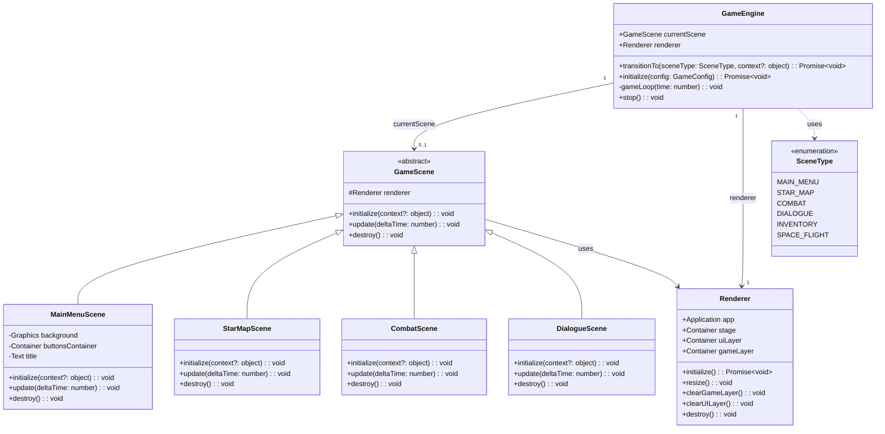

# PixiJS Renderer and Scene Management

## Requirements

Provide the visual foundation for Space Rangers: Neural Onslaught by implementing a production-ready PixiJS 8-based rendering engine with a manageable scene lifecycle system, enabling seamless transitions between game screens (Main Menu, Star Map, Combat, Dialogue) while maintaining 60 FPS performance and supporting WebGL with Canvas2D fallback.

**Definition of Done**:
- PixiJS canvas injected into DOM with WebGL (Canvas2D fallback)
- Abstract scene base class with lifecycle methods
- Minimum 4 concrete scene implementations
- Scene manager handles transitions without memory leaks
- Game loop integrated with scene updates
- Canvas2D fallback emits console warning

## Entities

## Approach

1. **Rendering Architecture**:
   - Wrap PixiJS 8 Application in Renderer class for encapsulation
   - Use layered Container hierarchy: stage → gameLayer + uiLayer
   - gameLayer for world objects, uiLayer for HUD/menus (maintains z-ordering)
   - Renderer handles initialization, resize, and cleanup

2. **Scene Lifecycle**:
   - Abstract GameScene class enforces `initialize()`, `update()`, `destroy()` contract
   - Constructor injection of Renderer ensures all scenes have rendering capability
   - `initialize(context)` receives optional context object for scene-specific data
   - `destroy()` must clean up all DisplayObjects to prevent memory leaks

3. **Scene Management**:
   - GameEngine.transitionTo() acts as scene manager
   - Immediate scene swap: destroy current → instantiate new → initialize
   - No transition animations in MVP (can be added later)
   - Switch-case maps SceneType enum to concrete scene classes

4. **Game Loop Integration**:
   - requestAnimationFrame drives game loop in GameEngine
   - Delta time calculated and passed to currentScene.update()
   - PixiJS ticker handles rendering automatically
   - Error handling wraps update calls for graceful recovery

5. **Fallback Strategy**:
   - PixiJS 8 auto-detects WebGL availability
   - Canvas2D fallback activated automatically when WebGL unavailable
   - Console warning emitted via logger for Canvas2D mode
   - Game remains fully playable on Canvas2D

## Structure

### Inheritance Relationships
1. `GameScene` abstract class defines scene lifecycle contract
2. `MainMenuScene` extends `GameScene` - main menu with buttons
3. `StarMapScene` extends `GameScene` - galaxy navigation
4. `CombatScene` extends `GameScene` - tactical combat grid
5. `DialogueScene` extends `GameScene` - NPC dialogue interface
6. `InventoryScene` extends `GameScene` - inventory management
7. `SpaceFlightScene` extends `GameScene` - real-time flight control

### Dependencies
1. `GameEngine` creates and manages `Renderer` instance
2. `GameEngine` instantiates concrete scenes via `transitionTo()`
3. All scenes receive `Renderer` via constructor injection
4. Scenes access `renderer.gameLayer` and `renderer.uiLayer` for DisplayObjects
5. Scenes access `renderer.app.screen` for dimensions

### Layered Architecture
1. **Presentation Layer** (`src/presentation/`): GameScene, Renderer, concrete scenes
2. **Systems Layer** (`src/systems/`): GameEngine orchestrates scenes and game loop
3. **Types Layer** (`src/types/`): SceneType enum, GameConfig interface

## Operations

### Create Renderer - `src/presentation/Renderer.ts`

1. **Responsibility**: Encapsulate PixiJS Application and provide layered container hierarchy
2. **Attributes**:
   - `app`: Application - PixiJS application instance
   - `stage`: Container - root container
   - `uiLayer`: Container - UI elements (buttons, HUD, menus)
   - `gameLayer`: Container - game world objects
   - `container`: HTMLElement - DOM element to mount canvas
3. **Methods**:
   - `constructor(container: HTMLElement)`: Store container reference, create empty Application and Containers
   - `initialize(): Promise<void>`:
     - Call `app.init()` with responsive sizing, background color, antialiasing, device pixel ratio
     - Check renderer type for Canvas2D fallback, log warning if canvas mode
     - Append canvas to container
     - Build container hierarchy: stage → gameLayer, stage → uiLayer
     - Add stage to app.stage
   - `resize(): void`: Call `app.renderer.resize()` with container dimensions
   - `clearGameLayer(): void`: Remove and destroy all children from gameLayer
   - `clearUILayer(): void`: Remove and destroy all children from uiLayer
   - `destroy(): void`: Call `app.destroy()` with full cleanup options
4. **Annotations**: None (plain TypeScript class)
5. **Constraints**: Must be initialized before any scene can render

### Create Abstract GameScene - `src/presentation/GameScene.ts`

1. **Responsibility**: Define scene lifecycle contract for all game scenes
2. **Attributes**:
   - `renderer`: Renderer - protected reference to rendering system
3. **Methods**:
   - `constructor(renderer: Renderer)`: Store renderer reference
   - `abstract initialize(context?: object): void`: Setup scene, create DisplayObjects
   - `abstract update(deltaTime: number): void`: Per-frame logic
   - `abstract destroy(): void`: Cleanup all resources
4. **Annotations**: Abstract class
5. **Constraints**: All concrete scenes must implement all three abstract methods

### Implement MainMenuScene - `src/presentation/MainMenuScene.ts`

1. **Responsibility**: Display main menu with game start options
2. **Attributes**:
   - `background`: Graphics | null - dark space background
   - `buttonsContainer`: Container | null - holds menu buttons
   - `title`: Text | null - game title text
   - `gameEngine`: GameEngine | null - reference for scene transitions
3. **Methods**:
   - `initialize(context?: object)`:
     - Extract gameEngine from context
     - Call `renderMainMenu()`
   - `update(deltaTime: number)`: Optional background animation
   - `destroy()`:
     - Clear any timeouts
     - Call `renderer.clearGameLayer()` and `renderer.clearUILayer()`
     - Null all references
   - `renderMainMenu()`:
     - Clear layers
     - Create background Graphics with dark color
     - Create title Text with game name
     - Create buttons: "New Game", "Continue", etc.
     - Set `eventMode = 'static'` and `cursor = 'pointer'` on buttons
     - Attach pointer handlers for transitions
4. **Annotations**: None
5. **Constraints**: Must have gameEngine reference for transitions to work

### Implement StarMapScene - `src/presentation/StarMapScene.ts`

1. **Responsibility**: Display navigable galaxy map with star systems
2. **Methods**:
   - `initialize(context?: object)`: Extract galaxy data, render star systems
   - `update(deltaTime: number)`: Handle pan/zoom, update animations
   - `destroy()`: Clear all star system graphics, null references

### Implement CombatScene - `src/presentation/CombatScene.ts`

1. **Responsibility**: Display tactical combat grid (placeholder)
2. **Methods**:
   - `initialize(context?: object)`: Render hexagonal grid placeholder
   - `update(deltaTime: number)`: Placeholder update
   - `destroy()`: Clear combat graphics

### Implement DialogueScene - `src/presentation/DialogueScene.ts`

1. **Responsibility**: Display NPC dialogue interface (placeholder)
2. **Methods**:
   - `initialize(context?: object)`: Render dialogue box placeholder
   - `update(deltaTime: number)`: Placeholder update
   - `destroy()`: Clear dialogue graphics

### Update GameEngine Scene Management - `src/systems/GameEngine.ts`

1. **Responsibility**: Orchestrate scene lifecycle and game loop
2. **Key Methods**:
   - `initialize(config: GameConfig)`:
     - Get game-container element from DOM
     - Create Renderer and call `renderer.initialize()`
     - Check for Canvas2D fallback
     - Call `transitionTo(SceneType.MAIN_MENU)`
     - Start game loop
   - `transitionTo(sceneType: SceneType, context?: object)`:
     - Verify renderer is initialized
     - If currentScene exists, call `currentScene.destroy()` and null it
     - Switch on sceneType to instantiate correct scene class
     - Call `currentScene.initialize(context)`
   - `gameLoop(time: number)`:
     - Calculate deltaTime from last frame
     - Call `currentScene?.update(deltaTime)`
     - Schedule next frame via requestAnimationFrame
   - `stop()`:
     - Cancel animation frame
     - Destroy current scene
     - Destroy renderer

### Add SceneType Enum - `src/types/index.ts`

1. **Responsibility**: Define scene identifiers
2. **Values**: MAIN_MENU, STAR_MAP, COMBAT, DIALOGUE, INVENTORY, SPACE_FLIGHT

## Norms

1. **Annotation Standards**:
   - No decorators needed (plain TypeScript classes)
   - Use `readonly` for immutable public properties
   - Use `private` for internal state

2. **Dependency Injection**:
   - Constructor injection for Renderer into scenes
   - Context object pattern for scene-specific data

3. **Exception Handling**:
   - Throw `GameSystemException` for renderer/scene errors
   - Error codes: `NO_CONTAINER`, `RENDERER_NOT_READY`, `INVALID_SCENE`
   - GameEngine.handleError() catches and displays errors

4. **Memory Management**:
   - Every `addChild()` must have corresponding `removeChild()` + `destroy()` in cleanup
   - Null all object references in `destroy()`
   - Clear timeouts/intervals in `destroy()`

5. **Logging**:
   - Use `logger.info()` for lifecycle events (initialized, destroyed, transitioned)
   - Use `logger.warn()` for Canvas2D fallback
   - Use `logger.error()` for failures

6. **Event Handling**:
   - Set `eventMode = 'static'` on interactive objects
   - Set `cursor = 'pointer'` for clickable elements
   - Remove event listeners implicitly via `destroy()`

## Safeguards

1. **Functional Constraints**:
   - Renderer must be initialized before any scene transition
   - Only one scene can be active at a time
   - Scene destroy() must be called before creating new scene

2. **Performance Constraints**:
   - Renderer initialization must complete in < 2 seconds
   - Scene transition latency must be < 100ms
   - Target 60 FPS (PixiJS ticker default)

3. **Memory Constraints**:
   - No DisplayObject leaks after scene destruction
   - All event listeners cleaned up on destroy
   - All references nulled after destroy

4. **Error Messages**:
   - `NO_CONTAINER`: "Game container not found in DOM."
   - `RENDERER_NOT_READY`: "Renderer not initialized."
   - `INVALID_SCENE`: "Unknown scene type: {sceneType}"

5. **Browser Compatibility**:
   - WebGL 1.0+ required for optimal performance
   - Canvas2D fallback for browsers without WebGL
   - Console warning for Canvas2D mode (not error)

6. **DOM Constraints**:
   - Requires element with id="game-container" in HTML
   - Canvas appended as child of game-container
   - Canvas size follows container size (responsive)

7. **Acceptance Criteria Traceability**:

| AC# | Description | Implementation |
|-----|-------------|----------------|
| AC1 | Renderer Initialization | Renderer.initialize() creates canvas, logs type |
| AC2 | Scene Switch to Star Map | MainMenuScene → transitionTo(STAR_MAP) |
| AC3 | Scene Switch to Combat | transitionTo(COMBAT) supported |
| AC4 | Return from Combat | transitionTo(STAR_MAP) remounts scene |
| AC5 | Canvas2D Fallback | Renderer checks type, logs warning |
