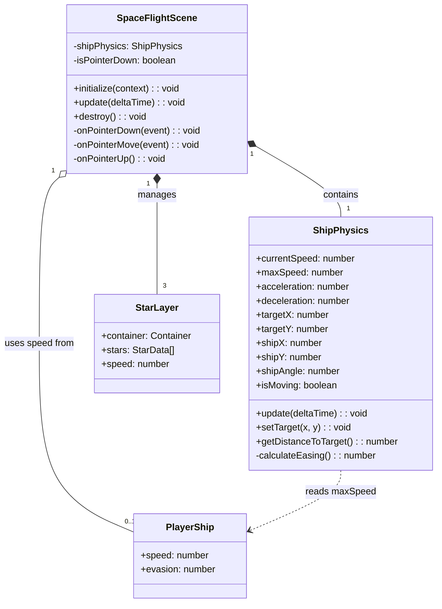

# Spaceship Mouse Control with Smooth Movement Interpolation

## Requirements

Enhance the SpaceFlightScene to provide physics-based ship movement with proper acceleration and deceleration curves, creating a polished space flight experience where the ship smoothly accelerates from rest, maintains cruising speed, and decelerates to stop at the target position. Support continuous pointer tracking for fluid cursor-following behavior.

## Entities



## Approach

1. **Physics-Based Movement**:
   - Replace linear movement with velocity-based physics model
   - Implement three-phase movement: acceleration → cruise → deceleration
   - Use easing function based on distance to target for smooth stopping
   - Deceleration zone calculated as `stoppingDistance = speed² / (2 * deceleration)`

2. **Continuous Input Tracking**:
   - Track pointerdown/pointerup state for continuous following
   - Update target position on pointermove when pointer is held
   - Use FederatedPointerEvent for unified mouse/touch handling

3. **Rotation Timing**:
   - Ensure rotation speed meets 300ms for 90° turn requirement
   - Calculate rotation speed as `rotationSpeed = (π/2) / 0.3 = 5.24 rad/s`
   - Ship rotates while moving, not sequentially

4. **Integration with Domain**:
   - Read maxSpeed from PlayerShip.speed when available
   - Fall back to default constants if no player context

## Structure

### Inheritance Relationships
1. SpaceFlightScene extends GameScene (existing)
2. ShipPhysics is a new internal class for movement state machine

### Dependencies
1. SpaceFlightScene depends on Renderer for display
2. SpaceFlightScene optionally depends on GameEngine for PlayerShip.speed
3. ShipPhysics is self-contained with configurable constants

### Layered Architecture
1. Presentation Layer: SpaceFlightScene handles rendering and input
2. Physics Layer: ShipPhysics handles movement calculations
3. Domain Layer: PlayerShip provides ship stats (read-only)

### Data Flow
```
PointerEvent → SpaceFlightScene.onPointerDown/Move
    → ShipPhysics.setTarget(x, y)
    → update(deltaTime)
    → ShipPhysics.update() calculates new position
    → SpaceFlightScene reads position and updates Container
```

## Operations

### Update SpaceFlightScene - Add Continuous Input Tracking

1. **Responsibility**: Handle pointer hold state for continuous ship following

2. **New Attributes**:
   - `isPointerDown: boolean` - tracks if pointer is currently held
   - `boundPointerMove: ((e: FederatedPointerEvent) => void) | null` - bound handler reference
   - `boundPointerUp: (() => void) | null` - bound handler reference

3. **Methods**:

   - `onPointerDown(event: FederatedPointerEvent): void`
     - Logic:
       - Set `isPointerDown = true`
       - Call `shipPhysics.setTarget(event.global.x, event.global.y)`
       - Add pointermove listener to stage

   - `onPointerMove(event: FederatedPointerEvent): void`
     - Logic:
       - If `isPointerDown` is false, return early
       - Call `shipPhysics.setTarget(event.global.x, event.global.y)`

   - `onPointerUp(): void`
     - Logic:
       - Set `isPointerDown = false`

4. **Lifecycle Updates**:
   - In `initialize()`: Bind all three pointer handlers, add pointerup/pointerupoutside listeners
   - In `destroy()`: Remove all pointer listeners, null out bound references

### Create ShipPhysics - Movement State Machine

1. **Responsibility**: Encapsulate physics-based movement with easing

2. **Attributes**:
   - `shipX: number` - current X position
   - `shipY: number` - current Y position
   - `shipAngle: number` - current rotation in radians
   - `targetX: number` - target X position
   - `targetY: number` - target Y position
   - `currentSpeed: number` - current velocity magnitude (starts at 0)
   - `maxSpeed: number` - maximum cruising speed (default 0.3, or from PlayerShip)
   - `acceleration: number` - speed increase per ms (default 0.001)
   - `deceleration: number` - speed decrease per ms (default 0.0015)
   - `rotationSpeed: number` - radians per ms (default 0.00524 for 300ms/90°)
   - `isMoving: boolean` - whether ship is in motion
   - `readonly STOP_THRESHOLD: number` - distance to consider "arrived" (10 pixels)

3. **Methods**:

   - `constructor(initialX: number, initialY: number, maxSpeed?: number)`
     - Logic:
       - Set shipX, shipY to initial position
       - Set targetX, targetY to same (no initial target)
       - Set maxSpeed from parameter or default 0.3
       - Initialize currentSpeed to 0
       - Calculate rotationSpeed as `(Math.PI / 2) / 300` rad/ms

   - `setTarget(x: number, y: number): void`
     - Logic:
       - Set targetX = x, targetY = y
       - Set isMoving = true

   - `getDistanceToTarget(): number`
     - Logic:
       - Return `Math.sqrt((targetX - shipX)² + (targetY - shipY)²)`

   - `update(deltaTime: number): void`
     - Logic:
       - Calculate distance to target
       - If distance <= STOP_THRESHOLD:
         - Set currentSpeed = 0, isMoving = false
         - Snap position to target if within threshold
         - Return
       - Calculate stopping distance: `currentSpeed² / (2 * deceleration)`
       - **Speed Update**:
         - If distance > stoppingDistance AND currentSpeed < maxSpeed:
           - Accelerate: `currentSpeed = Math.min(maxSpeed, currentSpeed + acceleration * deltaTime)`
         - Else if distance <= stoppingDistance:
           - Decelerate: `currentSpeed = Math.max(0, currentSpeed - deceleration * deltaTime)`
       - **Rotation Update**:
         - Calculate targetAngle = `Math.atan2(targetY - shipY, targetX - shipX)`
         - Calculate angleDiff, normalize to [-π, π]
         - Calculate maxRotation = rotationSpeed * deltaTime
         - Apply rotation: `shipAngle += clamp(angleDiff, -maxRotation, maxRotation)`
       - **Position Update**:
         - Calculate moveDistance = currentSpeed * deltaTime
         - Update shipX += cos(shipAngle) * moveDistance
         - Update shipY += sin(shipAngle) * moveDistance

4. **Constraints**:
   - deltaTime must be capped to prevent physics explosion (max 100ms)
   - Position must stay within screen bounds (optional, can wrap or clamp)

### Update SpaceFlightScene - Integrate ShipPhysics

1. **Responsibility**: Replace inline physics with ShipPhysics class

2. **Changes to initialize()**:
   - Create ShipPhysics instance with center position
   - If gameEngine?.player?.ship.speed exists, pass as maxSpeed
   - Remove inline physics variables (targetX, targetY, shipVelocity, speed)

3. **Changes to update(deltaTime)**:
   - Call `shipPhysics.update(deltaTime)`
   - Read position/angle from shipPhysics for container updates
   - Pass shipPhysics.currentSpeed to star field for parallax intensity

4. **Changes to updateShip()**:
   - Remove all inline physics calculations
   - Read from shipPhysics: shipX, shipY, shipAngle, isMoving
   - Keep ship drawing logic (engine glow based on isMoving)

5. **Changes to updateStarField()**:
   - Use shipPhysics.currentSpeed and shipPhysics.shipAngle for parallax direction
   - Replace `shipVelocity.x/y` with calculated vector from angle and speed

### Update SpaceFlightScene - Fix Rotation Timing

1. **Responsibility**: Ensure 90° rotation completes within 300ms

2. **Current Issue**: Uses percentage-based rotation (5% of remaining angle per frame)

3. **Fix**:
   - ShipPhysics uses fixed rotationSpeed = 5.24 rad/s
   - Rotation is clamped per frame, not percentage-based
   - This guarantees predictable rotation timing regardless of frame rate

## Norms

1. **Physics Constants**:
   - Define as readonly class properties, not magic numbers
   - Use descriptive names: `STOP_THRESHOLD`, `DEFAULT_MAX_SPEED`
   - Document units in comments (pixels, radians, milliseconds)

2. **Delta Time Handling**:
   - Always cap deltaTime: `const dt = Math.min(deltaTime, 100)`
   - Scale all physics by deltaTime for frame-rate independence
   - Use milliseconds consistently (PixiJS ticker uses ms)

3. **Event Handler Patterns**:
   - Bind handlers in initialize(), unbind in destroy()
   - Store bound references for proper removal
   - Use arrow functions or explicit .bind(this)

4. **PixiJS Conventions**:
   - Use FederatedPointerEvent for unified input
   - Set eventMode = 'static' on interactive objects
   - Clear filters array before destroying scene

5. **Logging**:
   - Use logger.debug() for frequent updates (position changes)
   - Use logger.info() for state changes (arrived at target)
   - Include relevant values in log messages

## Safeguards

1. **Functional Constraints**:
   - Ship must arrive within 10 pixels of target (AC5)
   - 90° rotation must complete within 300ms (NFR)
   - Touch and mouse input must behave identically (AC6)

2. **Performance Constraints**:
   - Maintain 60 FPS during movement and parallax
   - ShipPhysics.update() must complete in < 1ms
   - No object allocations in update loop (reuse vectors)

3. **Physics Constraints**:
   - currentSpeed must never go negative
   - currentSpeed must never exceed maxSpeed
   - deltaTime capped at 100ms to prevent tunneling

4. **Input Constraints**:
   - Pointer events must be removed on scene destroy
   - Multiple rapid clicks should update target, not queue

5. **Backward Compatibility**:
   - E2E helpers (e2eSetTarget, e2eClickBackToMap) must continue working
   - Scene lifecycle (initialize, update, destroy) unchanged
   - Parallax visual behavior maintained

6. **Testing Criteria**:
   - AC3: Ship arrives at click point within 2 seconds for typical distances
   - AC5: Observable acceleration phase, cruise phase, deceleration phase
   - Movement visually smooth without jitter or sudden stops
