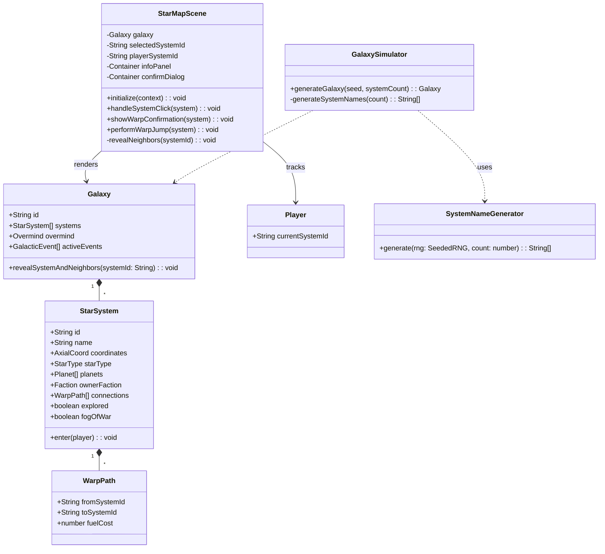

# Star Map Generation and Navigation — Implementation Fixes

## Requirements

Fix the star map navigation system to enable proper fog of war mechanics and warp confirmation, allowing players to explore a procedurally generated galaxy of 10 star systems with clickable nodes, confirmation dialogs before warping, and progressive fog-of-war reveal.

**Definition of Done**:
- Starting system AND its direct neighbors are visible on game start
- Warping to a system reveals it AND its direct neighbors
- Clicking a connected system shows confirmation dialog "Прыгнуть в систему X?" with "Да"/"Нет" buttons
- Systems have unique sci-fi themed names instead of "System N"
- System count is 10 (not 30)
- All 7 Acceptance Criteria pass

## Entities

## Approach

1. **Fog of War Fix**:
   - Add `revealSystemAndNeighbors(systemId)` method to Galaxy class
   - On game start: call reveal for starting system (reveals it + neighbors)
   - On warp: call reveal for destination system (reveals it + neighbors)
   - Reveal sets `explored = true` and `fogOfWar = false`

2. **Warp Confirmation Dialog**:
   - Add `showWarpConfirmation(system)` method to StarMapScene
   - Modal overlay with semi-transparent background
   - Text: "Прыгнуть в систему {name}?"
   - Two buttons: "Да" (executes warp) and "Нет" (closes dialog)
   - Disable background interactions while dialog is open

3. **System Name Generator**:
   - Create predefined list of 50+ sci-fi themed Russian/Latin names
   - Shuffle with SeededRNG for deterministic selection
   - Pick first N names for N systems

4. **System Count Configuration**:
   - Change default from 30 to 10 in GameEngine.initialize()
   - Keep parameter configurable for future expansion

5. **Click Flow Update**:
   - Click on connected system → show confirmation dialog (not immediate warp)
   - "Да" button → performWarpJump() → reveal neighbors → re-render
   - "Нет" button → close dialog, stay on current view

## Structure

### Inheritance Relationships
1. `StarMapScene` extends `GameScene` — no change
2. `SystemNameGenerator` is a new utility class (stateless)

### Dependencies
1. `GalaxySimulator` uses `SystemNameGenerator` for name generation
2. `StarMapScene` calls `Galaxy.revealSystemAndNeighbors()` on warp
3. `StarMapScene` manages `confirmDialog: Container` for warp confirmation
4. `GameEngine` passes `systemCount = 10` to `GalaxySimulator`

### Layered Architecture
1. **Domain Layer**: Galaxy gains `revealSystemAndNeighbors()` method
2. **Utils Layer**: New `SystemNameGenerator` utility
3. **Systems Layer**: GalaxySimulator updated to use name generator
4. **Presentation Layer**: StarMapScene gains confirmation dialog

## Operations

### Add revealSystemAndNeighbors to Galaxy — `src/domain/Galaxy.ts`

1. **Responsibility**: Reveal a system and all its direct neighbors (set explored=true, fogOfWar=false)
2. **Method**: `revealSystemAndNeighbors(systemId: string): void`
   - Find system by ID
   - Set `system.explored = true`, `system.fogOfWar = false`
   - For each connection in `system.connections`:
     - Find target system by `connection.toSystemId`
     - Set `target.explored = true`, `target.fogOfWar = false`
3. **Constraints**: If system not found, log warning and return (no throw)

### Create SystemNameGenerator — `src/utils/systemNameGenerator.ts`

1. **Responsibility**: Generate unique sci-fi themed system names
2. **Attributes**:
   - `SYSTEM_NAMES: string[]` — predefined list of 50+ names
3. **Methods**:
   - `generate(rng: SeededRNG, count: number): string[]`:
     - Copy SYSTEM_NAMES array
     - Shuffle using Fisher-Yates with rng
     - Return first `count` names
4. **Name List** (examples):
   - Солярис, Центавра, Арктур, Вега, Сириус, Альтаир, Денеб, Ригель
   - Андромеда, Кассиопея, Орион, Персей, Лира, Дракон, Феникс
   - Нова Прайм, Астра-7, Гелиос, Нептуния, Кронос, Титан
   - (50+ total names)

### Update GalaxySimulator — `src/systems/GalaxySimulator.ts`

1. **Changes to generateGalaxy()**:
   - Import and use SystemNameGenerator
   - Generate names array: `const names = SystemNameGenerator.generate(this.rng, systemCount)`
   - Use `names[i]` instead of `System ${i + 1}` when creating StarSystem

### Update GameEngine — `src/systems/GameEngine.ts`

1. **Change in initialize()**:
   - Change default systemCount from 30 to 10:
     `this.galaxy = simulator.generateGalaxy(seed, config.systemCount ?? 10)`

### Update StarMapScene — `src/presentation/StarMapScene.ts`

1. **Add confirmDialog attribute**:
   - `private confirmDialog: Container | null = null`

2. **Update initialize()**:
   - After setting playerSystemId, call:
     `this.galaxy?.revealSystemAndNeighbors(this.playerSystemId)`
   - This reveals starting system + neighbors

3. **Add showWarpConfirmation(system: StarSystem)**:
   - Clear existing confirmDialog if present
   - Create modal overlay (semi-transparent black background covering screen)
   - Set overlay `eventMode = 'static'` to block clicks
   - Create dialog box (centered, 300x150px, dark background with cyan border)
   - Add text: `Прыгнуть в систему ${system.name}?`
   - Add "Да" button:
     - `eventMode = 'static'`, `cursor = 'pointer'`
     - On click: call `performWarpJump(system)`, close dialog
   - Add "Нет" button:
     - `eventMode = 'static'`, `cursor = 'pointer'`
     - On click: close dialog only
   - Add dialog to `renderer.uiLayer`

4. **Add closeConfirmDialog()**:
   - Remove confirmDialog from parent
   - Destroy confirmDialog
   - Set confirmDialog = null

5. **Update showSystemInfo()**:
   - Change warpBtn click handler:
     - OLD: `this.performWarpJump(system)`
     - NEW: `this.showWarpConfirmation(system)`

6. **Update performWarpJump()**:
   - After setting `target.explored = true` and `target.fogOfWar = false`:
     - Call `this.galaxy?.revealSystemAndNeighbors(target.id)`
   - Call `this.closeConfirmDialog()` at the start

7. **Update destroy()**:
   - Add: `this.closeConfirmDialog()`

## Norms

1. **Modal Dialog Pattern**:
   - Modal overlay blocks all background interactions
   - Dialog centered on screen
   - "Да" button on left (primary action), "Нет" on right
   - Escape key should close dialog (optional enhancement)

2. **Fog of War Consistency**:
   - Always reveal via `Galaxy.revealSystemAndNeighbors()` — single source of truth
   - Never set `explored`/`fogOfWar` directly in scene code

3. **Name Generation**:
   - Names must be deterministic for given seed
   - No duplicate names in single galaxy
   - Mix of Russian and Latin astronomical terms for sci-fi feel

4. **Logging**:
   - Log system reveal: `logger.info(\`Revealed system: ${system.name} and ${neighbors.length} neighbors\`)`
   - Log warp confirmation shown: `logger.info(\`Warp confirmation for: ${system.name}\`)`

5. **Memory Management**:
   - confirmDialog must be destroyed in `closeConfirmDialog()` and `destroy()`
   - Overlay must not leak if scene is destroyed while dialog is open

## Safeguards

1. **Functional Constraints**:
   - Starting system + neighbors visible on game start (AC3)
   - Warp destination + neighbors revealed after jump (AC4)
   - Confirmation dialog required before warp (AC5)
   - Cannot warp to unconnected systems (AC7)

2. **UI Text (exact strings)**:
   - Confirmation prompt: `Прыгнуть в систему {name}?`
   - Yes button: `Да`
   - No button: `Нет`
   - No connection message: `Нет пути`

3. **System Count**:
   - Default: 10 systems
   - Minimum: 5 systems (for graph connectivity)
   - Maximum: 100 systems (performance limit)

4. **Performance**:
   - Galaxy generation < 1 second
   - 60 FPS with 10 systems and 15 warp lines

5. **Acceptance Criteria Traceability**:

| AC# | Description | Implementation |
|-----|-------------|----------------|
| AC1 | 10 systems, unique names, deterministic | GalaxySimulator + SystemNameGenerator |
| AC2 | 1-3 connections, connected graph | GalaxySimulator (existing, verify) |
| AC3 | Initial fog: start + neighbors visible | StarMapScene.initialize() → revealSystemAndNeighbors() |
| AC4 | Warp reveals destination + neighbors | StarMapScene.performWarpJump() → revealSystemAndNeighbors() |
| AC5 | Confirmation dialog with Да/Нет | StarMapScene.showWarpConfirmation() |
| AC6 | Warp updates player position + fog | StarMapScene.performWarpJump() (existing + fix) |
| AC7 | Unconnected = not clickable / "Нет пути" | StarMapScene.showSystemInfo() (existing) |
