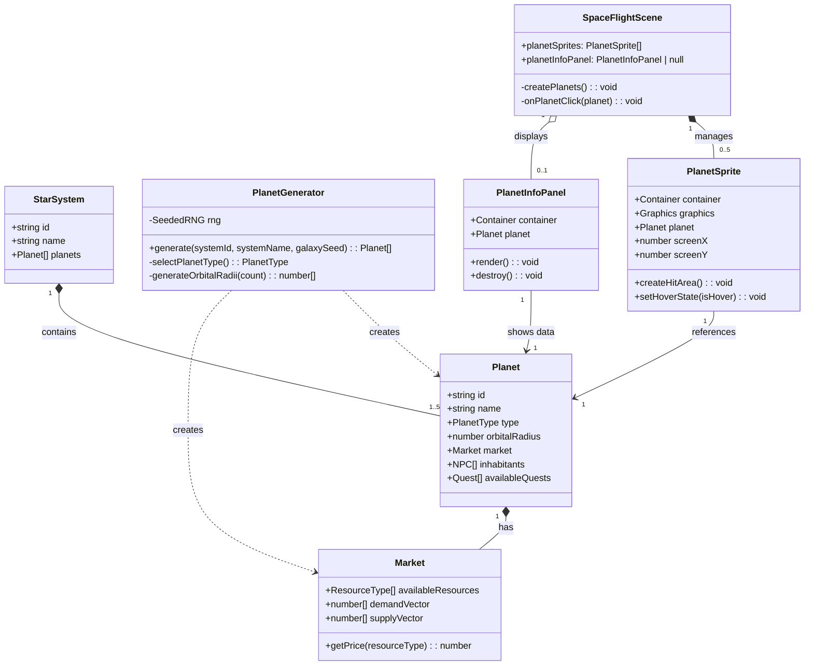

# Planetary System Generation and Display

## Requirements

Generate 1-5 unique planets for each star system using deterministic seeded RNG, display them as clickable orbital objects in the SpaceFlightScene, and enable ship navigation toward selected planets. Create the foundation for future planet-based gameplay (trading, landing, quests) while maintaining visual clarity and performance.

## Entities



## Approach

1. **Deterministic Planet Generation**:
   - Create `PlanetGenerator` class using `SeededRNG(galaxySeed + systemId)` for reproducibility
   - Generate 1-5 planets per system with weighted type distribution (terrestrial more common than gas giants)
   - Use system name + Roman numeral for planet names ("Солярис I", "Солярис II", etc.)
   - Assign orbital radii using fixed intervals (100px, 180px, 260px, 340px, 420px)

2. **Market Circular Reference Resolution**:
   - Create stub Market first with empty resources array
   - Create Planet with that Market reference
   - Market.planet field can be undefined or set after construction
   - This avoids circular dependency deadlock in constructors

3. **Visual Representation in SpaceFlightScene**:
   - Render star at screen center (implied star position)
   - Position planets at orbital radii from center with random initial angles
   - Use colored circles scaled by planet type (gas giants 1.5x larger)
   - Add hover glow effect for interactivity feedback

4. **Click Interaction**:
   - Use FederatedPointerEvent on planet Graphics objects
   - Show PlanetInfoPanel with planet name, type, orbital radius
   - Set ShipPhysics target to planet position for navigation
   - Panel positioned to avoid covering clicked planet

5. **Integration Points**:
   - GalaxySimulator calls PlanetGenerator during generateGalaxy()
   - SpaceFlightScene reads planets from current system via gameEngine
   - Reuse ShipPhysics from Story-7 for navigation to planet

## Structure

### Inheritance Relationships
1. PlanetSprite wraps PixiJS Container + Graphics (composition, not inheritance)
2. PlanetInfoPanel wraps PixiJS Container (composition)
3. PlanetGenerator is standalone utility class

### Dependencies
1. GalaxySimulator depends on PlanetGenerator for planet creation
2. SpaceFlightScene depends on PlanetSprite for rendering
3. PlanetSprite depends on Planet domain entity
4. PlanetGenerator depends on SeededRNG and Planet/Market constructors

### Layered Architecture
1. Domain Layer: Planet, Market (existing entities, no changes)
2. System Layer: GalaxySimulator extended with planet generation, PlanetGenerator utility
3. Presentation Layer: SpaceFlightScene extended with planet rendering, PlanetSprite, PlanetInfoPanel

### Data Flow
```
GalaxySimulator.generateGalaxy()
  → PlanetGenerator.generate(systemId, systemName, seed)
    → Create Planet[] with Markets
    → Store in StarSystem.planets

SpaceFlightScene.initialize()
  → Read planets from gameEngine.player.currentSystemId
  → Create PlanetSprite for each planet
  → Render at orbital positions

User clicks planet
  → onPlanetClick(planet)
    → Show PlanetInfoPanel
    → ShipPhysics.setTarget(planetX, planetY)
```

## Operations

### Create PlanetGenerator Utility

1. **Responsibility**: Generate deterministic planets for a star system

2. **Location**: `src/systems/PlanetGenerator.ts` (new file)

3. **Attributes**:
   - `rng: SeededRNG` - Random number generator
   - `ORBITAL_RADII: readonly number[]` - Fixed radii array `[100, 180, 260, 340, 420]`
   - `PLANET_TYPE_WEIGHTS: Map<PlanetType, number>` - Type distribution weights

4. **Methods**:

   - `constructor(galaxySeed: string, systemId: string)`
     - Logic:
       - Create `rng = new SeededRNG(galaxySeed + systemId)`
       - Initialize PLANET_TYPE_WEIGHTS map:
         - TERRESTRIAL: 40
         - ICE: 25
         - VOLCANIC: 15
         - GAS_GIANT: 10
         - INDUSTRIAL: 7
         - HABITAT: 3

   - `generate(systemName: string): Planet[]`
     - Logic:
       - Determine planet count: `count = rng.nextInt(1, 5)`
       - For i = 0 to count-1:
         - planetType = selectPlanetType()
         - planetName = `${systemName} ${toRomanNumeral(i + 1)}`
         - orbitalRadius = ORBITAL_RADII[i]
         - market = createStubMarket()
         - planet = new Planet(id, planetName, planetType, market, [], [])
       - Return planets array

   - `selectPlanetType(): PlanetType`
     - Logic:
       - Calculate total weight sum
       - Generate random value in [0, totalWeight)
       - Iterate through PLANET_TYPE_WEIGHTS to find selected type
       - Return selected PlanetType

   - `createStubMarket(): Market`
     - Logic:
       - Create Market with empty availableResources, empty vectors
       - Return market (planet reference will be undefined/null)

5. **Helper Function** (static utility):
   - `toRomanNumeral(num: number): string`
     - Map 1→I, 2→II, 3→III, 4→IV, 5→V
     - Return Roman numeral string

### Update GalaxySimulator - Add Planet Generation

1. **Responsibility**: Generate planets for each system during galaxy initialization

2. **Changes to generateGalaxy() method**:
   - After creating StarSystem (line 39-47), call PlanetGenerator
   - Replace line 44 `[]` with actual planets array:
     ```typescript
     const planetGen = new PlanetGenerator(seed, `sys_${i}`);
     const planets = planetGen.generate(systemNames[i]);
     ```
   - Pass `planets` to StarSystem constructor instead of `[]`

3. **Import**: Add `import { PlanetGenerator } from './PlanetGenerator'`

### Create PlanetSprite Component

1. **Responsibility**: Visual representation of a planet with click handling

2. **Location**: `src/presentation/PlanetSprite.ts` (new file)

3. **Attributes**:
   - `container: Container` - PixiJS container for planet graphics
   - `graphics: Graphics` - Planet circle and glow
   - `planet: Planet` - Domain entity reference
   - `orbitalRadius: number` - Distance from star (center)
   - `angle: number` - Angular position in radians
   - `screenX: number` - Calculated screen X position
   - `screenY: number` - Calculated screen Y position
   - `isHovered: boolean` - Hover state

4. **Methods**:

   - `constructor(planet: Planet, centerX: number, centerY: number, initialAngle: number)`
     - Logic:
       - Store planet reference
       - Store orbitalRadius from planet.orbitalRadius (custom property to add)
       - Store angle = initialAngle
       - Calculate screenX = centerX + cos(angle) * orbitalRadius
       - Calculate screenY = centerY + sin(angle) * orbitalRadius
       - Create container and graphics
       - Call render()

   - `render(): void`
     - Logic:
       - Clear graphics
       - Determine color and radius based on planet.type:
         - TERRESTRIAL: 0x8b7355 (brown), radius 12
         - GAS_GIANT: 0xffa500 (orange), radius 18
         - ICE: 0xadd8e6 (light blue), radius 10
         - VOLCANIC: 0xff4500 (red-orange), radius 11
         - INDUSTRIAL: 0x808080 (gray), radius 13
         - HABITAT: 0x00ff00 (green), radius 14
       - Draw planet circle at (0, 0) relative to container
       - If isHovered, draw glow (larger circle with alpha 0.3)
       - Position container at (screenX, screenY)

   - `createHitArea(onClickCallback: (planet: Planet) => void): void`
     - Logic:
       - Set graphics.eventMode = 'static'
       - Set graphics.cursor = 'pointer'
       - Add pointerdown listener → call onClickCallback(planet)
       - Add pointerover listener → setHoverState(true)
       - Add pointerout listener → setHoverState(false)

   - `setHoverState(isHover: boolean): void`
     - Logic:
       - Set isHovered = isHover
       - Call render() to update visual state

   - `destroy(): void`
     - Logic:
       - Remove all event listeners
       - Destroy container and graphics
       - Null references

5. **Custom Planet property**: Need to add `orbitalRadius: number` to Planet instances during generation

### Create PlanetInfoPanel Component

1. **Responsibility**: Display planet information on click

2. **Location**: `src/presentation/PlanetInfoPanel.ts` (new file)

3. **Attributes**:
   - `container: Container` - PixiJS container
   - `planet: Planet` - Planet to display
   - `panelWidth: number = 220`
   - `panelHeight: number = 140`

4. **Methods**:

   - `constructor(planet: Planet, screenWidth: number, screenHeight: number)`
     - Logic:
       - Store planet reference
       - Create container
       - Position panel at (screenWidth - 240, 80) (top-right, below map title)
       - Call render()

   - `render(): void`
     - Logic:
       - Create background Graphics (0x000000, alpha 0.8, stroke 0x00ffff)
       - Create title Text with planet.name (fontSize 14, fill 0x00ffff)
       - Create type Text "Type: ${planet.type}" (fontSize 11, fill 0xaaaaaa)
       - Create orbit Text "Orbit: ${planet.orbitalRadius}px" (fontSize 11, fill 0xaaaaaa)
       - Add all to container

   - `destroy(): void`
     - Logic:
       - Destroy all children
       - Remove container from parent
       - Null references

### Update SpaceFlightScene - Add Planet Display

1. **Responsibility**: Render planets and handle interactions

2. **New Attributes**:
   - `planetSprites: PlanetSprite[] = []`
   - `planetInfoPanel: PlanetInfoPanel | null = null`
   - `starCenterX: number` - Screen center X (star position)
   - `starCenterY: number` - Screen center Y (star position)

3. **Changes to initialize() method**:
   - After createNebulae(), call `this.createPlanets()`
   - Store center position:
     ```typescript
     this.starCenterX = this.renderer.app.screen.width / 2;
     this.starCenterY = this.renderer.app.screen.height / 2;
     ```

4. **New Methods**:

   - `createPlanets(): void`
     - Logic:
       - Get current system from gameEngine.player.currentSystemId
       - If no system or no planets, return
       - For each planet in system.planets:
         - Generate random initial angle: `rng.nextFloat(0, 2π)`
         - Create PlanetSprite(planet, starCenterX, starCenterY, angle)
         - Call sprite.createHitArea(this.onPlanetClick.bind(this))
         - Add sprite.container to gameLayer
         - Push sprite to planetSprites array

   - `onPlanetClick(planet: Planet): void`
     - Logic:
       - Close existing planetInfoPanel if any
       - Create new PlanetInfoPanel(planet, screen.width, screen.height)
       - Add panel.container to uiLayer
       - Get planet sprite's screenX, screenY
       - Call shipPhysics.setTarget(screenX, screenY) for navigation

5. **Changes to destroy() method**:
   - Destroy all planetSprites
   - Destroy planetInfoPanel if exists
   - Clear arrays

### Update Planet Entity - Add orbitalRadius Property

1. **Responsibility**: Store orbital distance as domain property

2. **File**: `src/domain/Planet.ts`

3. **Changes**:
   - Add `orbitalRadius: number` to constructor parameters (after type, before market)
   - Make it a public readonly property

4. **Update PlanetGenerator**: Pass orbitalRadius when creating Planet instances

## Norms

1. **Seeded RNG Usage**:
   - Always use SeededRNG for any randomness in generation
   - Combine galaxy seed with unique identifiers (systemId) for deterministic sub-seeds
   - Never use Math.random() in generation code

2. **PixiJS Component Patterns**:
   - Wrap PixiJS objects (Container, Graphics) in component classes
   - Implement destroy() method for proper cleanup
   - Use eventMode = 'static' for interactive objects
   - Store bound event handler references for removal

3. **Domain Entity Immutability**:
   - Planet properties should be readonly after construction
   - Only mutable state is Market vectors (expected game progression)
   - Do not modify planet arrays after galaxy generation

4. **Visual Consistency**:
   - Use Courier New font family for all text
   - Use 0x00ffff (cyan) for titles and highlights
   - Use 0xaaaaaa (gray) for secondary info text
   - Panel backgrounds: 0x000000 alpha 0.8, stroke 0x00ffff

5. **Logging Standards**:
   - Log planet generation summary: `logger.info('Generated ${count} planets for system ${systemName}')`
   - Log planet clicks: `logger.debug('Planet clicked: ${planet.name}')`
   - Use logger, not console.log

## Safeguards

1. **Functional Constraints**:
   - Each system must have 1-5 planets (AC1)
   - Planet generation must be deterministic for same seed (AC1)
   - Planets must be clickable with minimum 20px hit radius (NFR)
   - Planet type distribution must include at least 3 types across 10 systems (AC2)

2. **Performance Constraints**:
   - Planet generation per system must complete in < 100ms (NFR)
   - Total galaxy generation (10 systems × 5 planets max) < 500ms
   - Rendering 5 planets must maintain 60 FPS (PixiJS handles this easily)

3. **Visual Constraints**:
   - Planet colors must be distinct (different hues, not shades) (NFR)
   - Orbital radii must have minimum 70px separation to avoid overlap
   - Planet info panel must not cover entire screen (max 220×140px)
   - Hover glow effect must be visible against background

4. **Integration Constraints**:
   - Market creation must not throw on circular reference (handled by stub approach)
   - Planet data must persist in StarSystem.planets array
   - SpaceFlightScene must gracefully handle systems with 0 planets (shouldn't happen, but defensively check)

5. **Determinism Constraints**:
   - Same galaxySeed + systemId must always produce identical planets
   - SeededRNG state must not be shared across systems (create new instance per system)
   - Planet order in array must be deterministic (0→IV before I→V)

6. **Testing Criteria**:
   - Verify planet count is 1-5 for generated systems
   - Verify clicking planet shows info panel with correct data
   - Verify ship navigates toward clicked planet
   - Verify planets are visible and distinct in SpaceFlightScene
   - Verify determinism by generating same system twice and comparing planet properties
